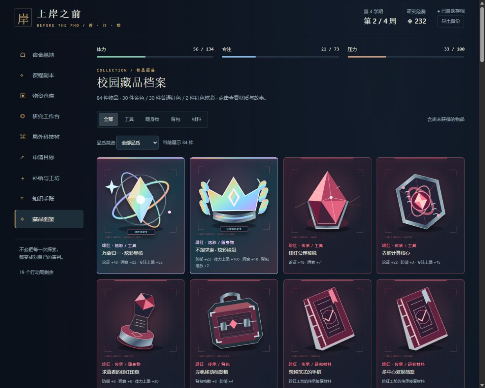
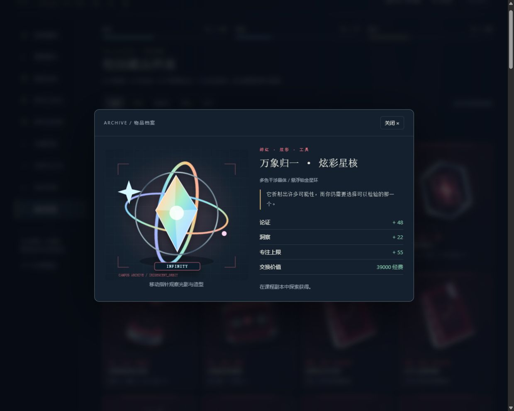

# 上岸之前 · Before the PhD

一款中文离线文字「搜 · 打 · 撤」小游戏。你是一名想去名校读 PhD 的大学生：在课程副本中寻找物资，用知识与论证解决问题，再带着收获赶上末班校园巴士。

**当前版本：V2.2 · 满载与远志。** 单机、无账号、无付费，运行时无需外部资源。



## 开始游玩

1. [下载 V2.2 完整包](https://github.com/songsiyi2006-chem/before-the-phd/raw/refs/heads/main/downloads/BeforeThePhD-v2.2.zip)，解压。
2. 用 Edge、Chrome 等现代浏览器打开包内的 `上岸之前.html`。
3. 新玩家领取学生证；已有玩家可在「存档」面板导入自己的 JSON 备份。

也可以克隆仓库，使用仓库根目录的 `index.html`。本地 HTTP 启动方式：

```sh
git clone https://github.com/songsiyi2006-chem/before-the-phd.git
cd before-the-phd
python -m http.server 8766 --bind 127.0.0.1
```

在浏览器中打开 `http://127.0.0.1:8766/index.html`。

自动存档保存在浏览器本地，使用 `before-phd-v1` 存储键；V1 可自动迁移，V2 的原有物品、科技和进度继续保留。更换浏览器、端口或打开方式时，请先导出存档再导入。仓库及下载包不含玩家存档。**不要把个人存档提交到仓库。**

## 有什么可玩

- **7 张课程地图**：大学数学、大学英语、体育、水课、STEM 专业课、科研实习、学术交流。
- **5 档难度**：预习、进阶、深研、资格试炼、学术深渊。逐级提高敌人强度、风险和高品质掉率。
- **84 件藏品**：22 件基础物品、30 件金色、30 件普通红色、2 件极稀有炫彩红色。每件有属性、材质和故事，25 件普通红色装备可定向制作。
- **多件事件奖励与背包取舍**：事件一次获得 2–6 件，装不下的逐件处理，整理进度可存档。仓库可按数量、品质批量出售。
- **36 节科技树、162 个升级等级**：三条路线长期投资，增加战斗能力、探索收益、估值与制作效率。
- **260 道知识题**：按基础、应用、深入分层，附解析、手账和错题练习。高难度战斗要求连续答对 2 / 3 题，任一题错则组合中断。
- **7 层申请目标**：从研究型项目逐步成长，MIT 为 720 综合分，并要求 6 个项目、英语 55、科研 110。首次 32 个行动周后结算，之后可自由研修，每 8 周再次申请。

申请分数、门槛和录取剧情都是**游戏规则**，不是现实院校招生标准。物品是原创 SVG 矢量插画与同系列变体，并非可自由旋转的三维模型。题库是概念练习，未经过独立学科专家审校。

## 炫彩藏品



「万象归一 · 炫彩星核」和「不熄求索 · 炫彩桂冠」在抽到红色品质后，各有 **0.1% 条件概率**出现。它们不可制作，没有独立炫彩保底。

例如无科技且未触发红色保底时，学术深渊每次普通物品抽取的每件炫彩概率是 **0.006%**，首领抽取是 **0.02%**。这不是每次出征的概率；事件的多件奖励分别抽取。游戏界面会显示计入科技后的概率。

## 源码与验证

无需 npm 安装。Python 用于把源文件内嵌成单个 HTML，Node.js 用于测试；源码采用普通 JavaScript、CSS 和 SVG。

```sh
# 在仓库根目录运行
python source/build.py build
node source/test.js
node source/test-v2.js
node source/test-v22.js
```

构建产物为 `build/上岸之前.html`。根目录 `index.html` 与 V2.2 的这一产物内容一致。修改源码后可重新构建并用新产物替换 `index.html`。

V2.2 已通过 44 组逻辑检查与 130 个固定种子全学程模拟，并在本地 HTTP 浏览器中检查了批量交易、满包队列、连题中途刷新及失败结算、图鉴、科技和分层申请。浏览器抽查包含 390 像素窄屏仓库布局。

这些是工程和部分界面验证，不代表长期真人平衡性研究。浏览器检查工具未自动实测 `file:` 双击启动。炫彩动画尊重减少动态效果的系统偏好。

## 目录

```text
index.html          可独立运行的游戏
source/             源码、构建脚本、三套测试
source/v1-backup/   旧版数据和引擎，仅用于兼容性检查
docs/               更新说明、藏品与科技清单、截图
downloads/          V2.2 完整包（游戏、源码、说明）
LICENSE             MIT
NOTICE.md           创作与内容说明
```

详见 [V2.2 更新说明](docs/V2.2更新说明.txt) 与 [藏品及科技清单](docs/藏品与科技清单.txt)。

## 许可

本仓库代码、文档与原创矢量插画采用 [MIT License](LICENSE)。院校名称及其他第三方名称不因本许可授予商标权，也不表示其认可本游戏。创作中使用了 OpenAI Codex 辅助，内容与验证范围见 [NOTICE.md](NOTICE.md)。
